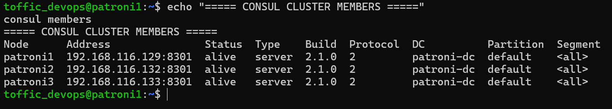
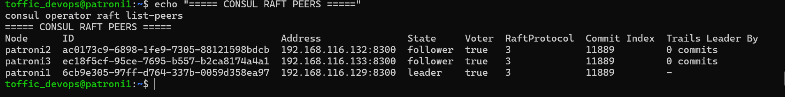
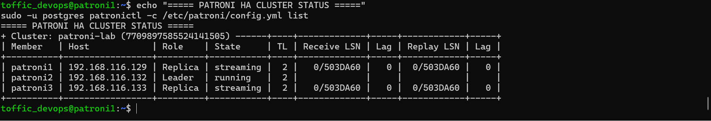
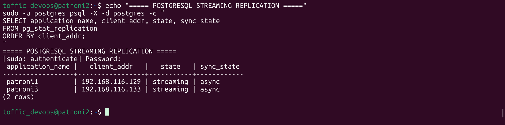
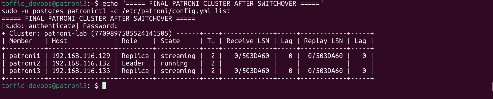

# PostgreSQL High Availability with Patroni and Consul

A three-node PostgreSQL high-availability lab built with **PostgreSQL 18, Patroni 4.1.0, and Consul** on Ubuntu virtual machines using VMware.

This project demonstrates how to deploy a PostgreSQL cluster, coordinate leader election through Consul, replicate data across multiple nodes, and perform a controlled switchover between database servers.

## Architecture

The lab consists of three Ubuntu virtual machines. Each node runs PostgreSQL, Patroni, and a Consul server.

| Node | IP Address | Initial Role |
|---|---|---|
| patroni1 | 192.168.116.129 | Initial Leader |
| patroni2 | 192.168.116.132 | Replica |
| patroni3 | 192.168.116.133 | Replica |

**Current cluster leader:** `patroni2` (after a successful controlled switchover).

### Architecture overview

- **PostgreSQL:** Database engine running on all three nodes.
- **Patroni:** Manages PostgreSQL high availability, replication, leader election, and failover.
- **Consul:** Distributed Configuration Store (DCS) used by Patroni to coordinate cluster state and leader ownership.
- **VMware:** Provides the virtual machine environment.

See [Architecture Documentation](docs/architecture.md) for more details.

## Technology Stack

| Technology | Version / Details |
|---|---|
| Operating System | Ubuntu 26.04.1 LTS |
| Database | PostgreSQL 18 |
| HA Management | Patroni 4.1.0 |
| Distributed Configuration Store | Consul 2.1.0 |
| Virtualization | VMware |
| Database Replication | Streaming replication |
| Cluster Nodes | 3 |

## Project Objectives

- Build a three-node PostgreSQL high-availability cluster.
- Configure Consul as Patroni's DCS.
- Configure one primary and two standby replicas.
- Verify streaming replication between nodes.
- Perform a controlled database switchover.
- Verify that replicas reconnect after leadership changes.
- Understand Patroni and Consul integration.

## Implementation

The project was completed in the following stages:

1. Prepared three Ubuntu virtual machines.
2. Installed and configured the Consul cluster.
3. Installed PostgreSQL 18 and Patroni 4.1.0 on all nodes.
4. Configured Patroni to use Consul as its DCS.
5. Bootstrapped the initial PostgreSQL primary.
6. Joined the other two nodes as replicas.
7. Verified streaming replication and data consistency.
8. Performed a controlled switchover from `patroni1` to `patroni2`.
9. Verified that the former leader rejoined as a replica.

## Validation Results

### Cluster health

The final validation showed:

| Node | Role | State | Replication Lag |
|---|---|---|---|
| patroni1 | Replica | Streaming | 0 |
| patroni2 | Leader | Running | — |
| patroni3 | Replica | Streaming | 0 |

### Data replication

A test record was inserted on the initial leader and successfully queried on both replicas.

Test message:

`Consul-backed Patroni replication test`

The same record was also verified on `patroni2` after it became the new leader.

### Controlled switchover

A controlled switchover was performed from `patroni1` to `patroni2`.

Results:
- `patroni2` successfully became the new leader.
- `patroni1` rejoined as a replica.
- `patroni3` remained a replica.
- PostgreSQL timeline advanced from 1 to 2.
- Both replicas resumed streaming from the new leader.

## Repository Structure

```text
patroni-consul-ha-lab/
├── README.md
├── .gitignore
├── docs/
│   ├── architecture.md
│   ├── prerequisites.md
│   ├── installation.md
│   ├── configuration.md
│   ├── replication-testing.md
│   ├── switchover-testing.md
│   └── troubleshooting.md
├── configs/
│   ├── patroni.example.yml
│   └── consul.example.hcl
└── screenshots/
```

## Important Notes

- This is a hands-on learning lab, not a production deployment.
- Replication is asynchronous.
- No backup system was configured as part of this lab.
- Consul is used as Patroni's DCS; it is not a replacement for PostgreSQL backups.
- Configuration examples will be sanitized before publication.
- Never commit database passwords, Consul ACL tokens, private keys, or other secrets.

## Learning Outcomes

Through this project, I gained practical experience with:

- PostgreSQL high availability.
- Patroni cluster management.
- Consul distributed coordination.
- PostgreSQL streaming replication.
- Leader election and controlled switchover.
- Linux service management and troubleshooting.
- Multi-node infrastructure deployment using VMware.

---
## Screenshots and Evidence

The following screenshots demonstrate the working Consul and Patroni high-availability cluster.

### Consul Cluster





### Patroni High Availability



### PostgreSQL Streaming Replication



### Controlled Switchover



## Automatic Failover Testing

Automatic failover and recovery were successfully tested by stopping the Patroni service on the original primary.

See [Automatic Failover Testing](docs/automatic-failover-testing.md) for the test procedure, results, and evidence.

**Author:** Toffic Mohammed  
**Project:** PostgreSQL HA with Patroni and Consul