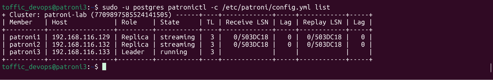

# Automatic Failover Testing

## Objective

Verify that Patroni automatically promotes a healthy PostgreSQL replica when the current primary's Patroni service becomes unavailable, using Consul as the Distributed Configuration Store (DCS).

## Initial Cluster State

| Node | Role | State | Timeline |
|---|---|---|---|
| patroni1 | Replica | Streaming | 2 |
| patroni2 | Leader | Running | 2 |
| patroni3 | Replica | Streaming | 2 |

All three Consul members were alive, and both replicas reported zero replication lag.

## Test Procedure

1. Connected to `patroni2`, the current primary.
2. Stopped its Patroni service using `sudo systemctl stop patroni`.
3. Observed the cluster from `patroni3` using `patronictl`.
4. Patroni automatically elected `patroni3` as the new primary.
5. Verified that `patroni1` continued streaming from the new primary.
6. Checked `SELECT pg_is_in_recovery();` on `patroni3`. The result was `false`, confirming it was the primary.
7. Queried the existing `ha_test` table and confirmed that the test record remained available.
8. Restarted Patroni on the former primary, `patroni2`, using `sudo systemctl start patroni`.
9. Verified that `patroni2` automatically rejoined as a streaming replica.

## Final Cluster State

| Node | Role | State | Timeline | Replication Lag |
|---|---|---|---|---|
| patroni1 | Replica | Streaming | 3 | 0 |
| patroni2 | Replica | Streaming | 3 | 0 |
| patroni3 | Leader | Running | 3 | — |

## Result

**PASS — Automatic failover and recovery verified.**

- Patroni automatically promoted `patroni3` after the Patroni service on `patroni2` was stopped.
- The PostgreSQL timeline advanced from 2 to 3.
- The existing test record remained available on the new primary.
- The original primary rejoined automatically as a replica.
- All three nodes returned to a healthy cluster state with zero reported replication lag.

## Evidence

## Important Notes

- This test simulated primary Patroni service failure, not a complete VM or Consul cluster outage.
- The cluster uses asynchronous streaming replication. Zero lag was observed during this test, but asynchronous replication does not guarantee zero data loss in every failure scenario.
- Automatic failover depends on Consul quorum availability and healthy eligible replicas.